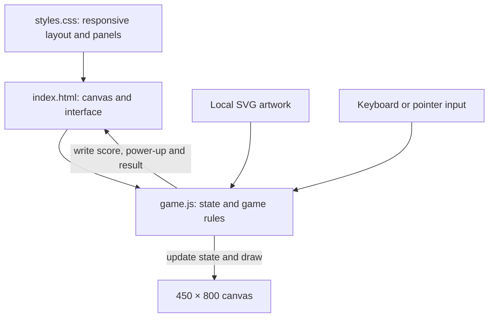
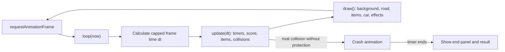
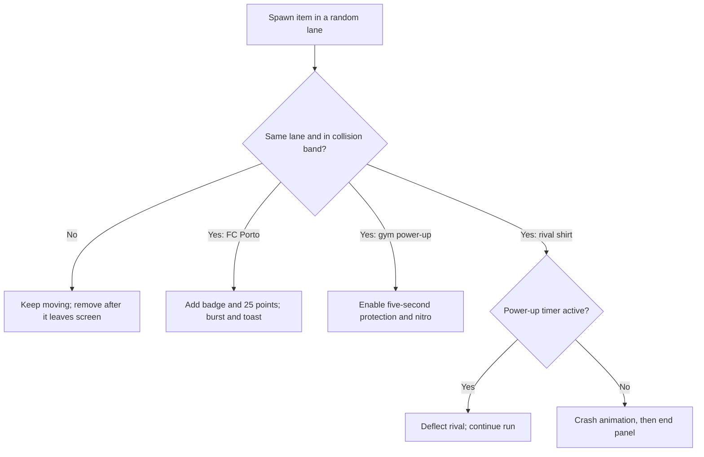

# Audi Runner — Christmas Edition

A small Portuguese Christmas themed endless runner made as a Secret Santa gift. Drive the Audi A3, collect FC Porto badges, pick up the gym power-up, and avoid the Benfica and Sporting shirts.

## Run the game

Open `index.html` in a modern browser. The project is static: it has no install step, server requirement, package manager, or build process.

## Project files

| File | Purpose |
| --- | --- |
| `index.html` | Canvas, score HUD, start and end panels, and Portuguese copy. |
| `styles.css` | Responsive page layout, HUD and panels, button styles, and CSS animations. |
| `game.js` | Game state, animation loop, canvas drawing, collisions, score, power-up, and controls. |
| `assets/car/audi-a3-8v-rear.svg` | Rear-facing player car illustration. |
| `assets/collectibles/fcp.svg` | FC Porto collectible. |
| `assets/obstacles/slb.svg`, `assets/obstacles/scp.svg` | Rival-shirt obstacles. |
| `assets/powerup/halter.svg` | Gym power-up collectible. |

## How the game is structured

The HTML creates a fixed 450 × 800 canvas and the interface around it. CSS scales that canvas to fit a phone or desktop viewport. JavaScript keeps the game state, updates it once per animation frame, then redraws the scene on the canvas.

### Frame loop

`requestAnimationFrame` calls `loop`. The elapsed time since the previous frame (`dt`) is used to update movement and timers consistently across different frame rates. `update` advances the score, speed, road, items, effects, and power-up timer. `draw` renders the winter background, road, items, car, and particle effects.

### Items, scoring, and collisions

Items spawn in one of three lanes and move down the canvas. Their size and horizontal position are scaled with their distance from the road's vanishing point to create perspective. An item is collected when it is in the player's lane and enters the vertical collision band (`y` between 600 and 710).

- **FC Porto badge:** adds one to the badge count and 25 points. The score also increases gradually as the game runs.
- **Benfica or Sporting shirt:** starts the end-of-run crash sequence unless the gym power-up is active.
- **Gym power-up:** activates five seconds of protection and nitro effects. Rival shirts hit during this time are deflected and do not end the run.
- **Missed item:** continues off screen and is removed.

Item rolls are 40% FC Porto, 20% Benfica, 20% Sporting, and 20% gym power-up. The lane is chosen randomly. The game speed rises with score and is capped at 500 before the temporary nitro multiplier.

## Controls

| Action | Keyboard | Touch / pointer |
| --- | --- | --- |
| Change lane left/right | Left/Right arrows or A/D | Swipe left/right on the canvas |
| Jump | Up arrow, W, or Space | Swipe up |
| Slide | Down arrow or S | Swipe down |

Left and right select one of three lanes. Jump raises the drawn car briefly. Slide currently records a short slide timer, but does not change the car drawing or collision rules. Rival-shirt collisions are determined by lane and vertical position; jumping does not avoid them.

## Visual effects

- **Winter scene:** a vertical color gradient, block-built skyline and lit windows, looping snow dots, a perspective road, dashed lane dividers, and a string of colored Christmas lights.
- **Perspective items:** collectibles grow as they approach the car and bob and tilt slightly while moving.
- **Car movement:** the Audi gently bobs, leans when changing lanes, rises during a jump, and shakes/flashes in the crash sequence. The asset itself is the local rear-facing SVG.
- **SVG depth:** canvas shadows are drawn behind the car and items; they do not change collision areas.
- **Collect and impact feedback:** colored particles burst outward and fade under simulated gravity. When protection deflects a rival, two expanding, fading rings appear with another particle burst.
- **Nitro:** while the five-second power-up timer is active, road and items move 1.3 times faster, the distance score grows at the corresponding rate, and pale cyan wind streaks stream outward from the road's vanishing point toward the foreground. Flickering blue-white flames are drawn at the Audi's twin exhausts. The existing toast and HUD timer show when the effect is active.
- **Interface:** the start/end panels float in and the car emoji on those panels floats gently. The canvas car and the panel emoji are separate visuals.

Particles, waves, road movement, item animation, and game timers use the frame's elapsed time, so their duration is not tied to a particular monitor refresh rate. The CSS also reduces panel/car animation for users who enable reduced motion in their operating system; canvas gameplay effects are not currently disabled by that preference.

## External dependencies and browser APIs

There are **no external libraries, services, fonts, or network-loaded assets**. All illustrations are local SVG files referenced with relative paths.

The game uses built-in browser APIs: the Canvas 2D context for rendering, `requestAnimationFrame` for the game loop, `Image` for loading SVGs, and DOM events for keyboard, pointer, and button input. A modern browser with Canvas 2D support is required. The source also uses JavaScript features such as optional chaining, template strings, and `Object.entries`.

## Editing notes

- Keep asset URLs relative so the page can be opened directly from disk.
- Keep the canvas coordinate space at 450 × 800; CSS handles the display size.
- Start and replay buttons use one `click` handler each. Avoid adding another `pointerup` handler to those buttons, which could make them trigger twice.
- Preserve the personal Christmas message in the end panel unless the requested change is specifically about that message.
